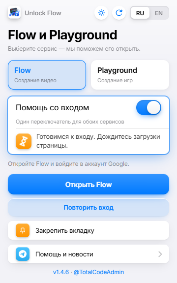
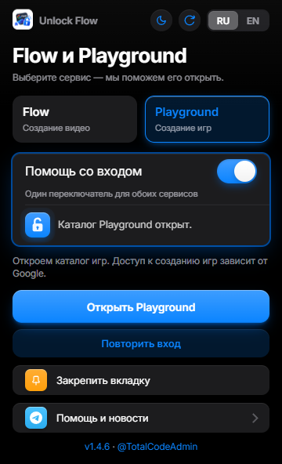

# Unlock Flow

Unlock Flow — расширение для Chrome и Firefox, которое помогает открыть Google Flow и каталог Playground при региональных ограничениях. Оно автоматически применяет способ входа для выбранного сервиса: Flow для создания видео или Playground для просмотра игр.

Также доступен скрипт для Tampermonkey с той же логикой входа для обоих сервисов.

В одном окне можно выбрать сервис, включить помощь со входом, открыть или закрепить вкладку и проверить обновления. При первом входе в Playground расширение ждёт, пока вы завершите настройку игрового профиля Google, затем продолжает переход в каталог.

Для Playground проверен вход в каталог; доступ к созданию игр и лимиты аккаунта зависят от Google и отдельно не проверялись. На некоторых подключениях дополнительно требуется DNS-сервис с обходом геоблокировок — одного расширения может быть недостаточно.

[Скачать расширение и обновления](https://github.com/Kam300/Unlock-Flow/releases) · [ Канал автора в Telegram](https://t.me/TotalC0de) · [English](README.en.md)

## Скриншоты

Flow в светлой теме и Playground в тёмной. Статусы на скриншотах показаны для примера.

| Flow · светлая тема | Playground · тёмная тема |
|:---:|:---:|
|  |  |

## Какой файл скачать

- Chrome: `Unlock-Flow-v<версия>.zip`, например `Unlock-Flow-v1.4.8.zip`.
- Firefox: `Unlock-Flow-Firefox-v<версия>.zip`.
- Tampermonkey: `Unlock-Flow-Tampermonkey-v<версия>.user.js` — один скрипт для Flow и Playground.
- Архивы Source code на странице релиза — исходники проекта. Для установки
   выбирайте готовый ZIP расширения с названием Unlock-Flow.

## Установка в Chrome

1. Скачайте ZIP для Chrome и распакуйте его в отдельную постоянную папку.
2. Откройте `chrome://extensions` и включите «Режим разработчика».
3. Нажмите «Загрузить распакованное расширение» и выберите папку,
   в которой находится `manifest.json`.
4. Не удаляйте и не перемещайте эту папку после установки.

## Обновление в Chrome

1. В окне расширения нажмите ↻ или номер версии, затем «Скачать обновление».
2. Распакуйте ZIP в ПРЕЖНЮЮ папку расширения с заменой файлов.
3. Снова откройте расширение и нажмите «Файлы заменены — перезапустить».
4. Обновите вкладку Flow или Playground.

Не удаляйте расширение и не загружайте вторую копию.
Если кнопки перезапуска в старой версии нет, нажмите ↻ на карточке расширения
на странице `chrome://extensions` после замены файлов.

## Установка в Firefox (142 или новее)

1. Скачайте ZIP с Firefox в названии. Распаковывать его не нужно.
2. Откройте `about:debugging#/runtime/this-firefox`.
3. Нажмите «Загрузить временное дополнение…» и выберите скачанный ZIP.

Сборка пока не подписана Mozilla. После полного закрытия Firefox временное
дополнение удалится, и его нужно будет загрузить снова.
Для постоянной установки требуется сборка с подписью Firefox.

## Обновление в Firefox

1. Нажмите ↻ или номер версии в окне расширения, затем «Скачать обновление».
   Проверка обновлений доступна начиная с версии 1.4.6 и скачивает Firefox ZIP.
2. На странице `about:debugging#/runtime/this-firefox` нажмите
   «Загрузить временное дополнение…» и выберите новый ZIP.
3. Если Firefox не позволяет заменить дополнение, удалите прежнюю временную
   копию на этой странице, затем загрузите новый ZIP.

В версии 1.4.5 скачайте новый Firefox ZIP со страницы релизов вручную.
Кнопка «Файлы заменены — перезапустить» предназначена для Chrome.

## Установка через Tampermonkey

1. Установите [Tampermonkey](https://www.tampermonkey.net/) для своего браузера.
2. Откройте [скрипт установки](https://raw.githubusercontent.com/Kam300/Unlock-Flow/main/tampermonkey/unlock-flow.user.js)
   и нажмите «Установить» в Tampermonkey.
3. Откройте или обновите вкладку [Flow](https://flow.google.com/)
   или [Playground](https://playground.google/404?login_success=1&pli=1).

В Chrome разрешите Tampermonkey запуск пользовательских скриптов:
`chrome://extensions` → Tampermonkey → «Подробнее» → «Разрешить пользовательские скрипты».
Если этого пункта нет, включите «Режим разработчика».
[Инструкция Tampermonkey](https://www.tampermonkey.net/faq.php?locale=en#Q209).

Локальная установка: откройте файл `tampermonkey/unlock-flow.user.js`, скопируйте
его целиком в Tampermonkey → «Создать новый скрипт» и сохраните через Ctrl+S.

**Обновление:** Tampermonkey проверяет обновления автоматически. Для ручной
проверки откройте его панель управления и выберите проверку обновлений скрипта.
После обновления перезагрузите вкладку сервиса.

Выберите один вариант установки: расширение Unlock Flow или скрипт.
У скрипта нет окна расширения; включение и выключение доступны в Tampermonkey.
После переключения обновите вкладку сервиса. В Firefox скрипт сохраняется
между перезапусками браузера. При первом входе в Playground завершите настройку
игрового профиля Google; скрипт дождётся её окончания.

Для разработчиков: `node pack-userscript.js` собирает скрипт из `hook.js` и
`playground.js` и создаёт файл для релиза в `dist/`. Проверка актуальности:
`node pack-userscript.js --check`.

## Как пользоваться расширением

Выберите Flow или Playground и нажмите основную кнопку открытия.
«Включить и открыть» включает помощь и открывает сервис одним нажатием.
Переключатель общий для обоих сервисов. Уже открытые вкладки используются повторно.
При первом входе в Playground завершите настройку игрового профиля Google.
Расширение дождётся закрытия этого окна и продолжит переход в каталог.
Для Playground проверен вход в каталог. Создание игр и лимиты аккаунта
отдельно не проверялись; доступ к ним зависит от Google.

## Playground не открывается — попробуйте другой DNS

Автоматический вход помогает не на всех подключениях. Если Playground остаётся
на `/region-unavailable`, расширению не удалось открыть сервис самостоятельно.
В этом случае попробуйте DNS-сервис с обходом геоблокировок и поддержкой Playground.
Могут работать разные такие сервисы: результат зависит от провайдера и вашей сети.
Обычная смена DNS не гарантирует смену региона.

Пользователь подтвердил работу с [GeoHide](https://geohide.ru/).
Адрес DNS-over-HTTPS: `https://geohide.ru/dns-query`.
Это один из вариантов, а не обязательный провайдер или гарантия доступа.

В настройках браузера найдите «Безопасный DNS» или «DNS через HTTPS», выберите
пользовательский провайдер и укажите его адрес. Сохраните настройку, затем нажмите
«Повторить вход» в расширении или обновите вкладку, если используете Tampermonkey.
При необходимости перезапустите браузер. Расширение и скрипт сами DNS не меняют.
